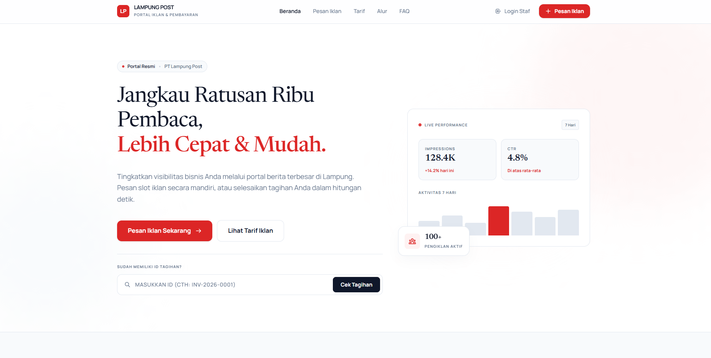
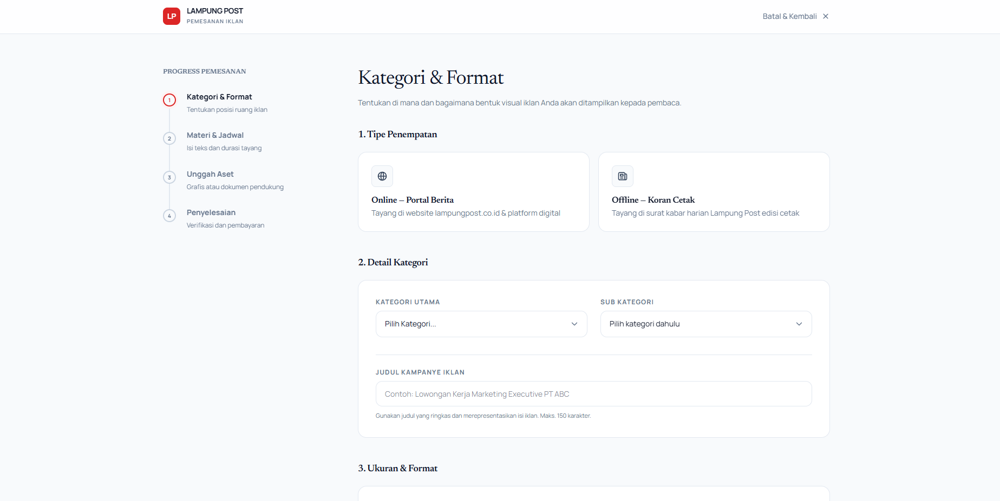
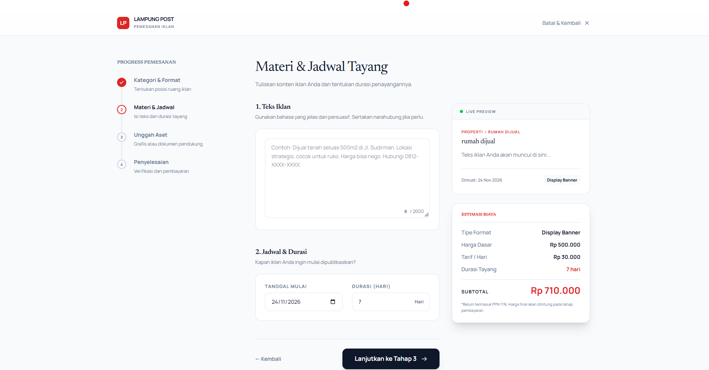
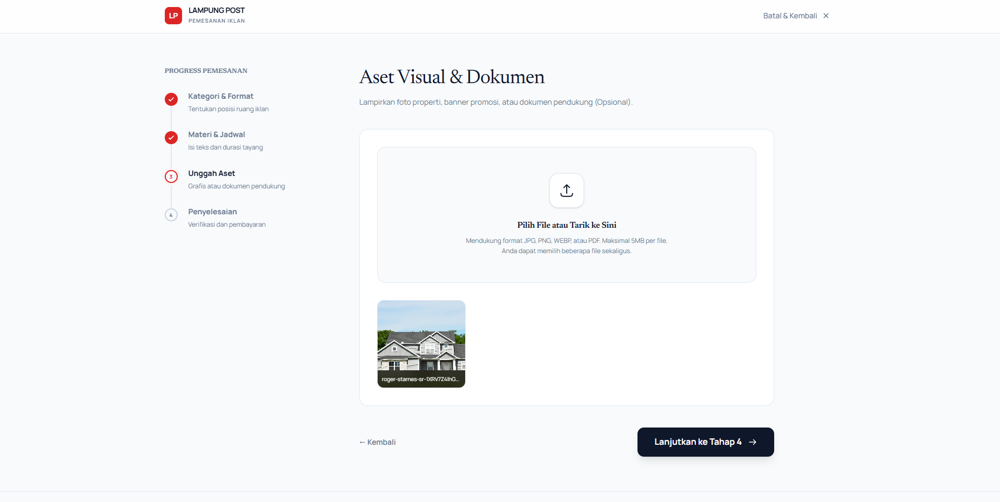
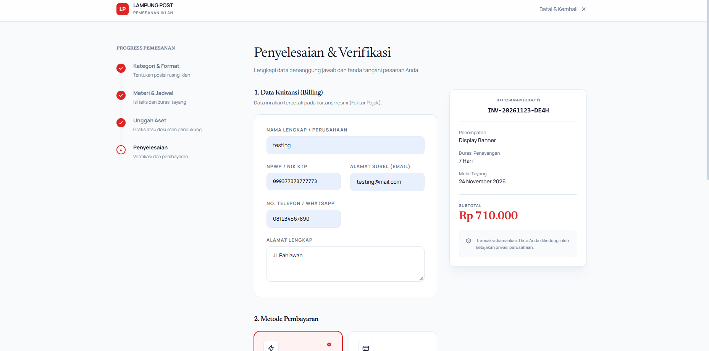
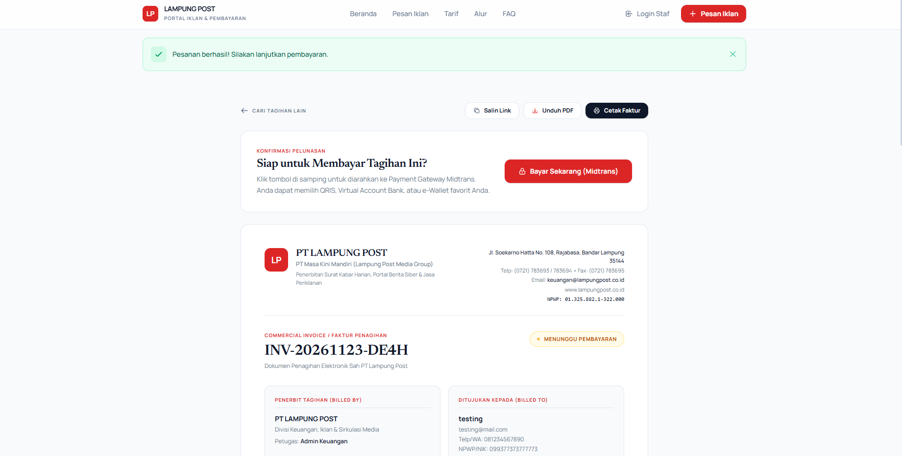
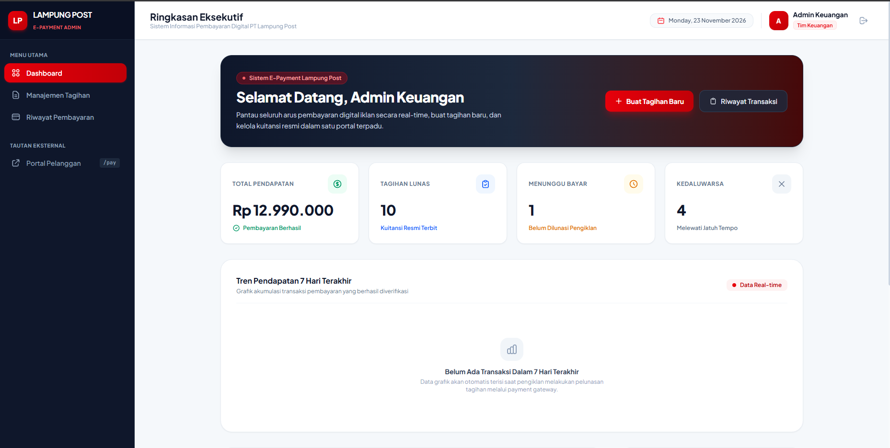
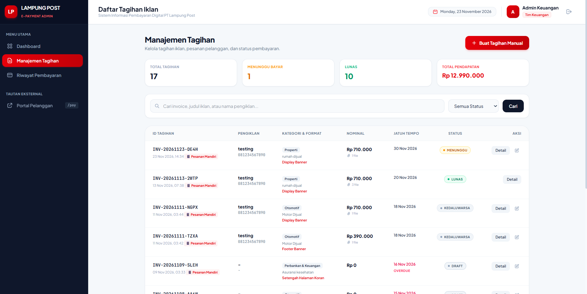

# E-Payment & Portal Pemesanan Iklan — Lampung Post


Sistem informasi pemesanan slot iklan mandiri (*self-service ad booking*) dan pembayaran elektronik terintegrasi untuk **PT Masa Kini Mandiri / Harian Umum Lampung Post**. Aplikasi ini mendigitalisasi keseluruhan alur pemasangan iklan—mulai dari pemilihan format iklan cetak maupun digital, kalkulasi tarif otomatis, pembubuhan tanda tangan elektronik, hingga penerbitan tagihan dan verifikasi pembayaran secara *real-time*.

---

## Daftar Isi

- [Tentang Proyek](#tentang-proyek)
- [Fitur Utama](#fitur-utama)
- [Pratinjau Antarmuka](#pratinjau-antarmuka)
- [Teknologi yang Digunakan](#teknologi-yang-digunakan)
- [Arsitektur Alur Pemesanan](#arsitektur-alur-pemesanan)
- [Instalasi & Konfigurasi Lokal](#instalasi--konfigurasi-lokal)
- [Konfigurasi Otomatisasi (Cron Job)](#konfigurasi-automatisasi-cron-job)
- [Lisensi](#lisensi)

---

## Tentang Proyek

Proses pemesanan iklan konvensional sering kali memerlukan koordinasi manual yang panjang untuk penentuan ukuran, perhitungan harga berdasarkan durasi tayang, persetujuan dokumen, hingga konfirmasi transfer. 

**E-Payment Lampost** hadir sebagai portal terpadu yang memungkinkan pengiklan (individu maupun instansi/korporasi) memesan ruang iklan di portal berita **lampungpost.co.id** maupun surat kabar harian **Lampung Post Edisi Cetak** secara transparan, cepat, dan terdokumentasi secara hukum.

---

## Fitur Utama

### 1. Portal Pemesanan Iklan 4 Tahap (Public Booking Wizard)
* **Tahap 1 — Kategori & Format Iklan:** Pemilihan kanal penayangan (*Online — Portal Berita* atau *Offline — Koran Cetak*), kategori dan sub-kategori terstruktur, serta pilihan format/dimensi iklan (*Display Banner, Sidebar, In-Article, Footer, Half Page, Quarter Page, Full Page, Advertorial,* hingga *Iklan Kolom/Baris*).
* **Tahap 2 — Materi, Jadwal & Kalkulator Biaya:** Penyusunan naskah iklan (hingga 2.000 karakter) yang dilengkapi dengan **Live Ad Preview**, pemilihan tanggal mulai tayang, pengaturan durasi (1–90 hari), serta kalkulasi estimasi biaya otomatis (`Base Price + Tarif Harian × Durasi`).
* **Tahap 3 — Unggah Aset Media:** Dukungan unggah multi-file untuk materi visual (JPG, PNG, WEBP) maupun dokumen pendukung (PDF) hingga 5 MB per berkas.
* **Tahap 4 — Data Penagihan & Tanda Tangan Elektronik:** Formulir identitas penanggung jawab (NPWP/NIK KTP, kontak, alamat) untuk keperluan kuitansi resmi, pemilihan preferensi pembayaran, serta **E-Signature Pad** berbasis HTML5 Canvas yang merekam tanda tangan digital beserta *timestamp* dan alamat IP pemesan sesuai ketentuan UU ITE.

### 2. Sistem Pembayaran & Integrasi Midtrans
* **Pembayaran Instan (Otomatis):** Terintegrasi dengan Midtrans untuk mendukung transaksi melalui QRIS, Virtual Account bank nasional, dan e-Wallet dengan pembaruan status tagihan otomatis melalui *Webhook/Callback*.
* **Transfer Manual:** Opsi pembayaran melalui rekening resmi perusahaan dengan alur verifikasi oleh tim keuangan.
* **Manajemen Siklus Tagihan:** Pelacakan status tagihan terstruktur (`draft`, `unpaid`, `paid`, `expired`, `failed`) dengan penomoran otomatis (`INV-YYYYMMDD-XXXX`).

### 3. Dashboard Administrasi & Manajemen Invoice
* **Ringkasan Keuangan & Operasional:** Pemantauan total pendapatan (*Total Revenue*), jumlah tagihan lunas (*Paid*), menunggu pembayaran (*Unpaid*), dan kedaluwarsa (*Expired / Overdue*).
* **Analitik Pendapatan:** Visualisasi grafik tren pendapatan 7 hari terakhir (*7-Day Revenue Chart*).
* **Pengelolaan Pesanan & Invoice:** Peninjauan detail naskah iklan, pengunduhan aset media pengiklan, verifikasi tanda tangan elektronik, serta pengelolaan status tagihan.

---

## Pratinjau Antarmuka

Berikut adalah tampilan antarmuka utama dari sistem **E-Payment Lampost**:

### Halaman Publik & Alur Pemesanan
| Halaman Beranda (Landing Page) | Tahap 1: Kategori & Format Iklan |
| :---: | :---: |
|  |  |

| Tahap 2: Materi, Live Preview & Estimasi Biaya | Tahap 3: Unggah Aset Media |
| :---: | :---: |
|  |  |

| Tahap 4: Data Penagihan & E-Signature | Halaman Checkout & Pembayaran |
| :---: | :---: |
|  |  |

### Panel Administrator
| Dashboard Analitik Admin | Manajemen Data Invoice |
| :---: | :---: |
|  |  |

---

## Teknologi yang Digunakan

| Komponen | Teknologi |
| :--- | :--- |
| **Backend Framework** | Laravel (PHP 8.3+) |
| **Frontend & Styling** | Blade Templates, Tailwind CSS, Vite |
| **Tipografi & UI** | Newsreader (Editorial Serif), Manrope (Geometric Sans), Signature Pad v4.1.7 |
| **Database** | MySQL / MariaDB |
| **Payment Gateway** | Midtrans Snap & Webhook API |

---

## Arsitektur Alur Pemesanan

```text
[Pengiklan]
    │
    ├──► Step 1: Pilih Penempatan, Kategori & Format ──► Simpan Draft (status: draft)
    ├──► Step 2: Isi Teks Iklan & Durasi Tayang      ──► Kalkulasi Harga Otomatis
    ├──► Step 3: Unggah File Media / Dokumen (Opsional)
    └──► Step 4: Isi Billing + Tanda Tangan Digital  ──► Terbit Invoice (status: unpaid)
                                                               │
                         ┌─────────────────────────────────────┴─────────────────────────────────────┐
                         ▼                                                                           ▼
          [Metode: Bayar Online (Midtrans)]                                           [Metode: Transfer Manual]
                         │                                                                           │
         Pembayaran via QRIS / VA / e-Wallet                                         Transfer ke Rekening Perusahaan
                         │                                                                           │
         Midtrans Webhook Callback otomatis                                          Verifikasi oleh Tim Keuangan
                         │                                                                           │
                         └─────────────────────────────────────┬─────────────────────────────────────┘
                                                               ▼
                                             Invoice Lunas (status: paid)
                                    (Jika melewati jatuh tempo ──► status: expired)
```

---

## Instalasi & Konfigurasi Lokal

Ikuti langkah-langkah berikut untuk menjalankan proyek ini di lingkungan pengembangan lokal:

1. **Kloning Repositori**
   ```bash
   git clone https://github.com/MadeRaditya/E-Payment_Lampost.git
   cd E-Payment_Lampost
   ```

2. **Instalasi Dependensi Backend & Frontend**
   ```bash
   composer install
   npm install
   ```

3. **Konfigurasi Environment**
   Salin berkas `.env.example` menjadi `.env`, lalu sesuaikan konfigurasi database dan kredensial Midtrans Anda:
   ```bash
   cp .env.example .env
   php artisan key:generate
   ```

   Buka file `.env` dan sesuaikan variabel berikut:
   ```env
   APP_NAME="Lampung Post Ad Portal"
   APP_URL=http://localhost:8000

   DB_CONNECTION=mysql
   DB_HOST=127.0.0.1
   DB_PORT=3306
   DB_DATABASE=epayment_lampost
   DB_USERNAME=root
   DB_PASSWORD=

   # Konfigurasi Midtrans
   MIDTRANS_SERVER_KEY=your-midtrans-server-key
   MIDTRANS_CLIENT_KEY=your-midtrans-client-key
   MIDTRANS_IS_PRODUCTION=false
   ```

4. **Migrasi Database & Storage Link**
   ```bash
   php artisan migrate --seed
   php artisan storage:link
   ```

5. **Kompilasi Aset & Jalankan Server**
   ```bash
   npm run build
   php artisan serve
   ```
   Aplikasi dapat diakses melalui `http://localhost:8000`.

---

## Konfigurasi Otomatisasi (Cron Job)

Untuk memastikan sistem secara otomatis memperbarui status tagihan `unpaid` yang telah melewati batas jatuh tempo (`due_date`) menjadi `expired`, tambahkan entri Cron Job berikut pada server produksi:

```bash
cd /path-ke-direktori-project && php artisan schedule:run >> /dev/null 2>&1
```

---

## Lisensi & Kredit

Dirancang dan dikembangkan oleh **[Made Raditya](https://github.com/MadeRaditya)** untuk **PT Masa Kini Mandiri / Harian Umum Lampung Post**.

Hak Cipta &copy; 2026 PT Masa Kini Mandiri. Seluruh hak cipta dilindungi undang-undang. Kode sumber ini hanya ditujukan untuk operasional internal perusahaan dan tidak untuk didistribusikan ulang tanpa izin tertulis.
